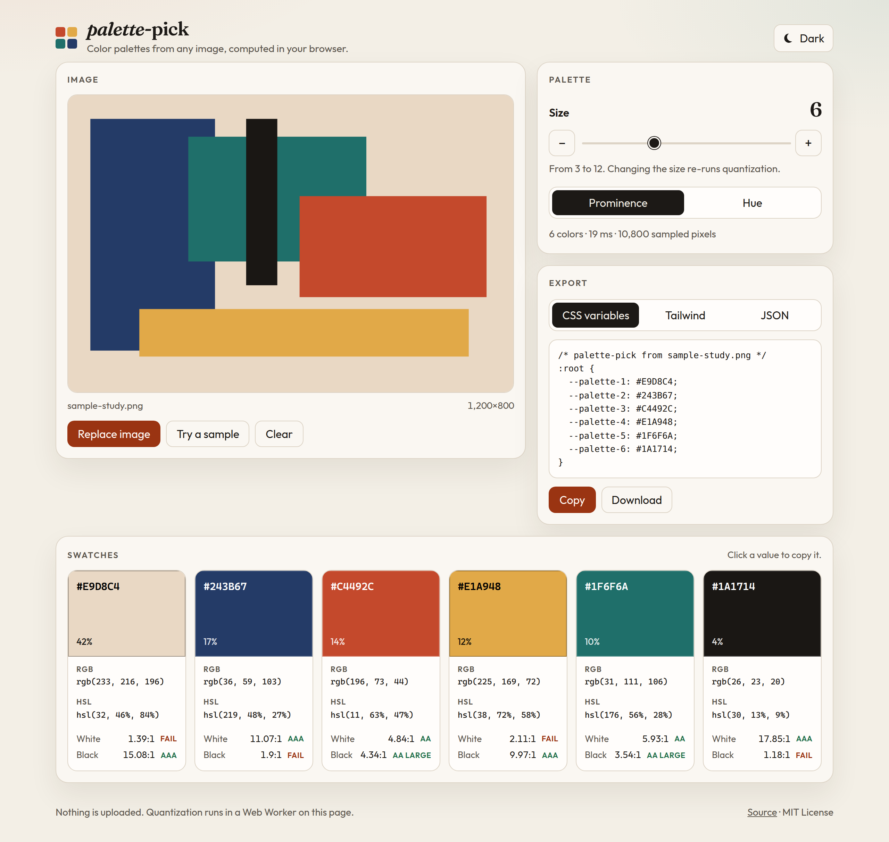

# palette-pick

Extract a color palette from any image, entirely in your browser.

**[Open the app](https://frozenmango8.github.io/palette-pick/)**



Drop, paste, or browse to an image. palette-pick samples the pixels locally, clusters them in CIELAB, and gives you swatches you can copy into CSS, Tailwind, or JSON. Nothing is uploaded.

[](https://github.com/frozenmango8/palette-pick/actions/workflows/ci.yml)

## Features

- Drag-and-drop, file picker, or paste an image anywhere on the page
- Palette size from 3 to 12, recomputed as you change it
- k-means++ in CIELAB, inside a Web Worker, so the page stays responsive
- Swatches with HEX, RGB, and HSL, each click-to-copy
- WCAG contrast ratio against white and black, graded AAA / AA / AA large / Fail
- Sort by prominence or by hue
- Export CSS custom properties, a Tailwind v3 config snippet, a Tailwind v4 `@theme` block, or JSON
- Light and dark theme, with the choice remembered
- Works with PNG, JPEG, GIF, WebP, and SVG, including transparency (transparent pixels are ignored)

## How it works

1. The file is decoded with `createImageBitmap` and drawn to a canvas whose longest side is 180px.
2. Pixels with alpha below 128 are dropped, so a transparent PNG is not mixed with an empty backdrop.
3. At most 12,000 opaque pixels are kept, using a uniform stride so the sample still covers the frame.
4. A Web Worker runs k-means++. Distances are in CIELAB, which tracks perceived difference better than raw RGB, so a small accent can still earn a cluster next to a large neutral area.
5. Each cluster's mean is converted back to sRGB. The seed is fixed, so the same image always produces the same palette.
6. If the image has fewer distinct clusters than the size you asked for, the shorter palette is what you get.

A palette is a summary. A photograph with dozens of distinct hues is reduced to the `k` strongest clusters, and a tiny mark that is both rare and close to a larger color can be absorbed. Flat artwork and illustrations come through cleanly. The bundled sample is a six-paint study you can use to see that.

### Privacy

After the page loads, palette-pick does not make network requests. There is no server and no analytics. Closing the tab discards the image.

## Local development

Requires Node 20 or newer.

```bash
npm install
npm run dev
```

| Script | What it does |
| --- | --- |
| `npm run dev` | Vite dev server |
| `npm test` | Unit tests for color math, quantization, sampling, sorting, and export |
| `npm run build` | Typecheck and production build into `dist/` |
| `npm run preview` | Serve the production build |

The dev server uses `/` as the base path. `npm run build` sets the base to `/palette-pick/` so asset URLs match GitHub Pages. Preview that build at `http://127.0.0.1:4173/palette-pick/`.

## Deploy

Pushes to `main` run [`.github/workflows/pages.yml`](.github/workflows/pages.yml), which builds the app and deploys it with the official GitHub Pages actions.

In the repository settings, set **Pages → Build and deployment → Source** to **GitHub Actions**. The site is published at <https://frozenmango8.github.io/palette-pick/>.

## Browser support

Current Chrome, Firefox, Safari, and Edge. The app needs `createImageBitmap`, canvas `getImageData`, `Worker` modules, and the Clipboard API (with a `document.execCommand('copy')` fallback).

## Contributing

See [CONTRIBUTING.md](CONTRIBUTING.md).

## License

[MIT](LICENSE) © 2026 frozenmango8
